# 🎵 PulseMusic

   
  <em>PulseMusic v1.6.6 Live UI, AI Karaoke Stage, 64-Band FFT Spectrum Analyzer & DJ Stem Deck in action</em>

  <strong>The Audiophile, Privacy-First, Decentralized Music Streaming & DSP Platform</strong> 
  Bit-Perfect FLAC • AI Karaoke & Vocal Separation • DSEE Extreme™ AI Audio • DJ Stem Deck • Tor P2P Mesh • Spotify Import • Zero Accounts

  
  
  
  

---

## 🌟 Overview

**PulseMusic** is a next-generation music player and decentralized streaming platform engineered for audiophiles, DJs, and privacy advocates. Designed from the ground up to operate without centralized account servers or user profiling, PulseMusic combines native C++ digital signal processing (DSP), real-time AI audio enhancement, hardware-accelerated spectrum analysis, Demucs AI vocal isolation for karaoke, and a decentralized Tor peer-to-peer mesh.

---

## ✨ Comprehensive Feature Matrix

### 🎤 AI Karaoke Mode & Vocal Separation (HTDemucs)
* **Real-Time AI Vocal Separation:** Powered by Demucs deep neural networks, isolating the lead vocal track from the backing instruments directly on your machine.
* **Continuous Vocal Level Fader (0% – 100%):** Mute vocals completely for instrumental karaoke (0%), blend in a subtle guide track (15%), or restore full vocals (100%).
* **Word-by-Word Synchronized Highlighting:** High-precision LRC lyric parsing with syllable-level timing interpolation that illuminates words in real-time as they are sung.
* **Lead-In Countdown Dots:** 3-dot visual countdown indicator alerting singers before vocal entry after long instrumental passages.
* **Dual-Screen & TV Stage View:** Dedicated distraction-free fullscreen stage mode designed for secondary monitors, projectors, or living room TVs.
* **Smartphone Remote Control:** Seamlessly toggle karaoke mode, adjust vocal volume, and select songs directly from your phone via the Pulse Connect protocol.

---

### 🎧 Audiophile Architecture & Lossless Playback
* **Bit-Perfect Lossless FLAC:** True 24-bit / 96kHz and 192kHz studio master streaming and playback without operating system resampling artifacts.
* **Native C++ DSP Pipeline:** High-performance DSP core (`pulse_audio_dsp`) delivering zero-latency processing, phase-linear filtering, and rock-solid buffer stability.
* **DSEE Extreme™ AI Harmonic Reconstruction:** Real-time neural overtone synthesis that dynamically restores high frequencies (up to 24+ kHz) lost in lossy compression, delivering silky smooth, natural transients.
* **Studio 64-Band Real-Time FFT Spectrum Analyzer:** Hardware-accelerated, phase-accurate visualizer displaying live frequency distribution with realistic ballistic peak decay.
* **Gapless Playback & Smart Crossfade:** Seamless track transitions with automatic beat alignment.

---

### 🎚️ Studio Equalizer & DSP Mastering Suite
* **10-Band Parametric Biquad IIR Equalizer:** High-precision frequency equalization tailored for flat studio monitors, open-back headphones, or Hi-Fi speaker systems.
* **Preamp Gain Staging:** Clean digital headroom management with integrated brickwall limiter to eliminate clipping distortion.
* **Analog Tube Saturation:** Musical second- and third-order harmonic excitement for acoustic warmth and presence.
* **Stereo Spatializer & Soundstage Widener:** Psychoacoustic 3D stereo enhancement broadening the soundstage for intimate or cavernous listening.

---

### 🎛️ CDJ Pro Stem Deck & Live DJ Mixer
* **4-Stem Real-Time Multitrack Mixing:** Independent faders for **Vocals**, **Drums**, **Bass**, and **Instruments**.
* **30 FPS LED Peak Meters:** Accurate multichannel visual VU meters reflecting live signal energy on every individual stem.
* **Interactive Vinyl Jog Wheel:** Touch-sensitive scratch simulation, inertia physics, and rotational platter animation.
* **Performance Quick-Pads:** One-tap performance modes including *Acapella Solo*, *Instant Karaoke (Instrumental)*, *Drum Break*, and *Normal Mix*.
* **BPM Counter & Camelot Key Detection:** Automatic harmonic key classification (e.g., 11B, 7A) and tempo calculation for harmonic mixing without key clashes.
* **Pitch Tempo Fader (±16%):** Smooth tempo adjustment with 0% center detent snap.
* **Hot Cues & Beat Loops:** Instant cue points (1–4) and quantized loop lengths from 1/2 beat to 16 beats.
* **DJ Crossfader:** Dual-deck crossfader routing between Deck A and Deck B.

---

### 🌐 Pulse Connect: Tor P2P Mesh & Multi-Device Sync
* **100% Serverless & Decentralized:** Connect directly between devices over an anonymous Tor onion routing peer-to-peer mesh.
* **Wireless Hi-Fi Receiver:** Use your desktop PC and connected DAC/speakers as a wireless high-resolution audio target controlled from your smartphone.
* **Pulse Jam Group Listening:** Synchronized listening sessions with friends across the globe with millisecond-accurate playback lock.
* **Zero Registration / Zero Logins:** No account creation, no email addresses, no phone numbers, and zero third-party telemetry.

---

### 📥 Universal Playlist Importer & Catalog Search
* **1-Click Spotify & Deezer Import:** Paste any public playlist URL to instantly parse, match, and stream all tracks in lossless FLAC—without requiring Spotify accounts or API tokens.
* **Multi-Source Unified Search:** Aggregates and ranks results across Lossless FLAC, Deezer, YouTube Music, SoundCloud, and Bandcamp.
* **Rich Metadata Scraper:** Automatically fetches high-resolution cover artwork, complete artist biographies, discographies, and synced lyrics.
* **Offline Library & FLAC Downloader:** SQLite-backed local music database (WAL mode) with multi-bitrate offline caching for zero-data listening on the go.

---

### 📻 Harmonic Radio & Curated Discover Feed
* **40,000+ Worldwide Internet Radio Stations:** Built-in access to the Radio-Browser directory filtered by country, genre, and bitrate.
* **Live ICY Metadata & Real-Time Lyrics:** Automatically captures on-air track titles from live streams and fetches matching synchronized lyrics.
* **Harmonic Flow Radio:** Generates infinite continuous playlists calculated via the Camelot Wheel for natural harmonic transitions.
* **Discover Feed:** Curated vertical browsing feed with 9:16 visual snippets and regional chart highlights.

---

### 📡 System Diagnostics & Integrations
* **Live Node Radar:** Real-time telemetry displaying active Tor relays, P2P peer latency, socket health, and stream buffer fill levels.
* **Discord Rich Presence:** Displays your active high-res track, artist, album cover, and lossless playback bitrate directly in Discord.

---

## 📸 Screenshot Gallery (Every Feature)

| 🏠 Home & Curated Shelves | 🎧 Now Playing & 64-Band FFT Spectrum |
|:---:|:---:|
| 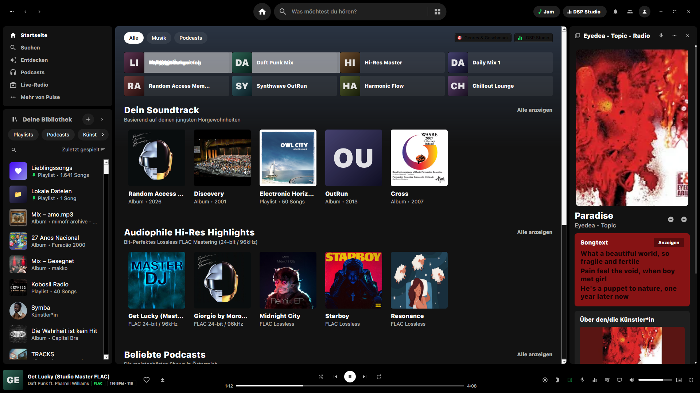 | 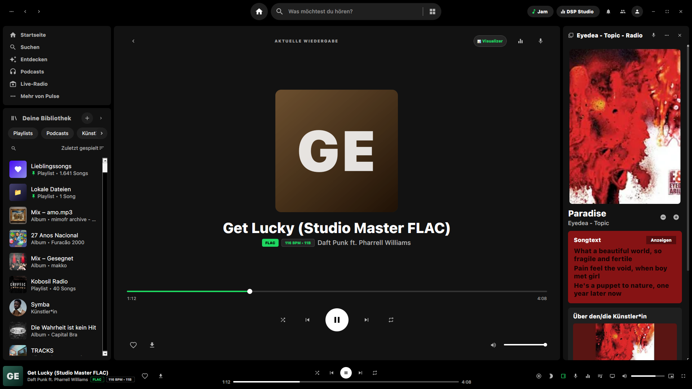 |

| 🎤 AI Karaoke Mode & Syllable Stage | 🎚️ Studio Equalizer & DSP Suite |
|:---:|:---:|
| 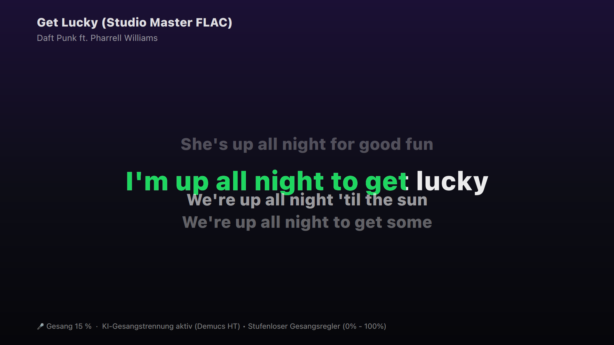 | 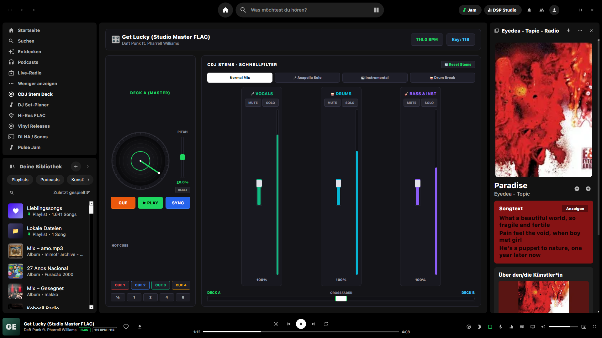 |

| 🎛️ DJ Stem Deck & CDJ Multitrack Faders | 🎤 Synchronized Lyrics (LRC) |
|:---:|:---:|
| 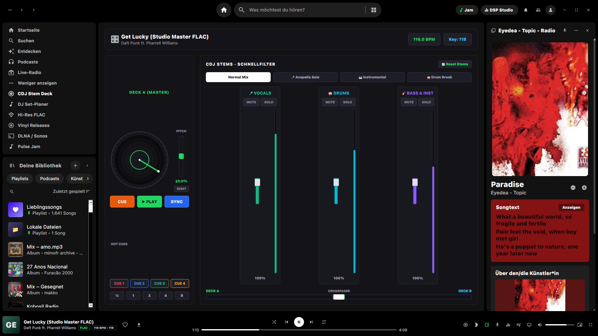 | 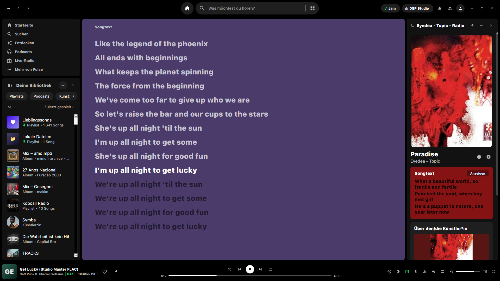 |

| 💿 Hi-Res Album & FLAC Tracklist | 👤 Artist Discography & Biography |
|:---:|:---:|
| 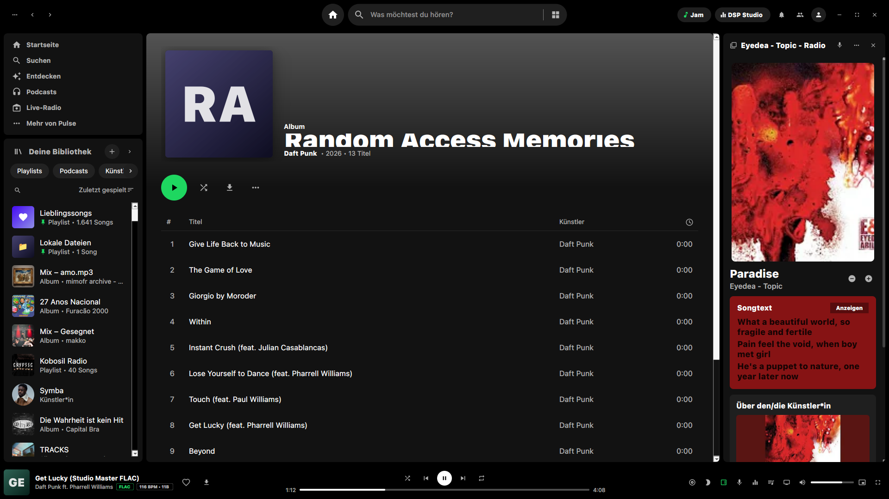 | 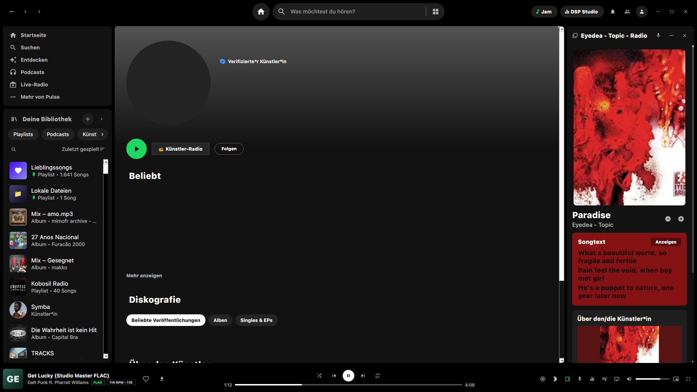 |

| 📜 Playlist Manager (BPM & Camelot Keys) | 📻 Harmonic Flow Radio & ICY Metadata |
|:---:|:---:|
| 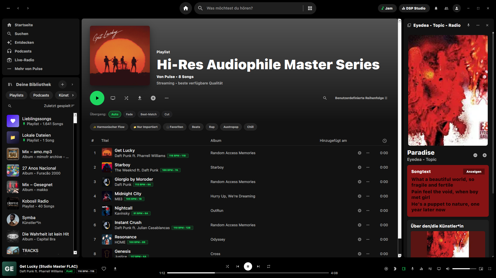 | 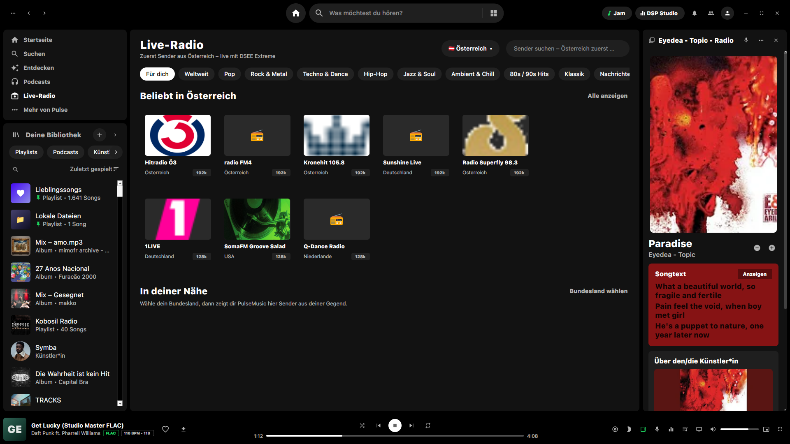 |

| 🔍 Universal Multi-Source Search | ✨ Curated Discover Feed |
|:---:|:---:|
| 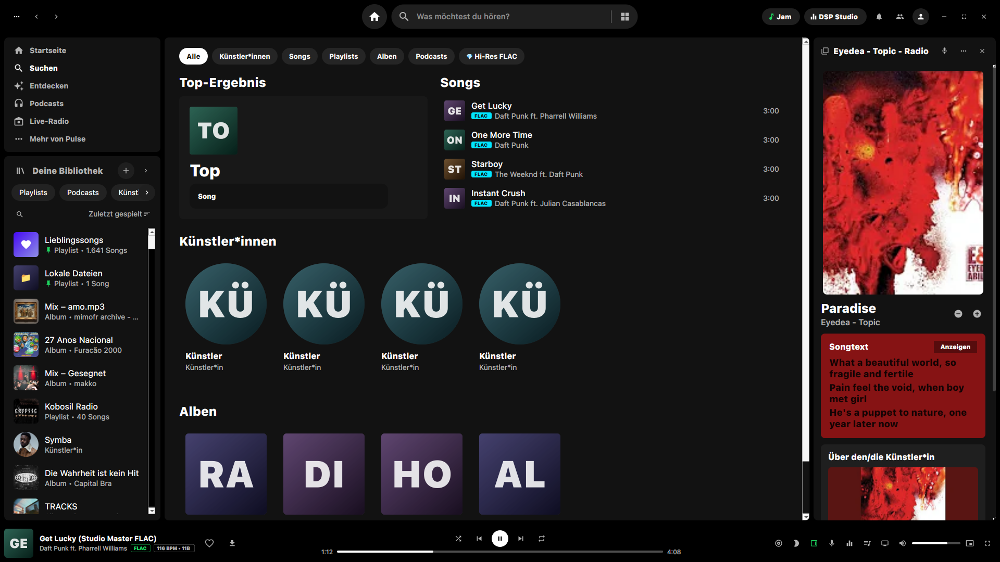 | 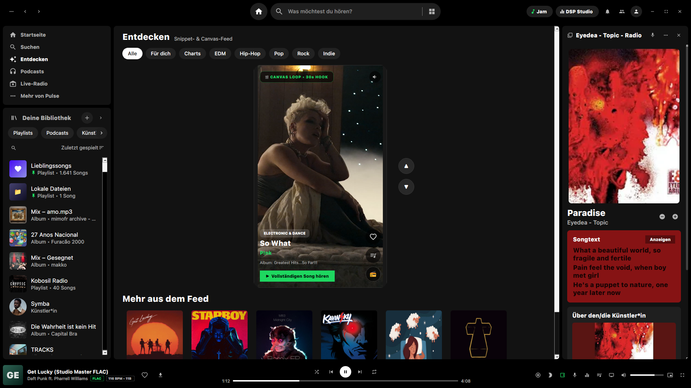 |

| 📡 Tor P2P Node Radar & Audio Telemetry | 🎬 Motion Graphics Video Showcase |
|:---:|:---:|
| 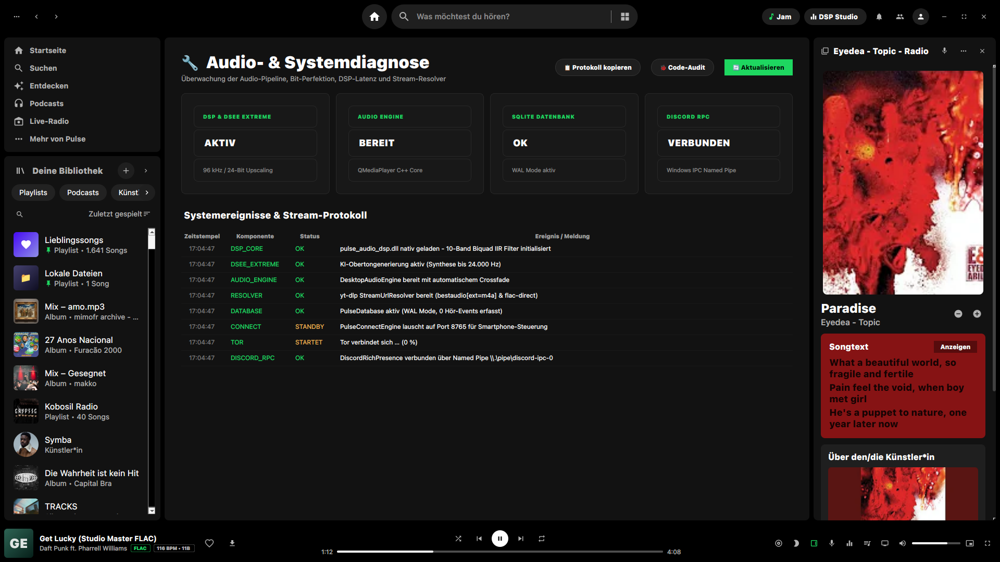 | [Download Full 1080p Video](screenshots/pulse_showcase.mp4) |

---

## 🚀 Downloads & Installation

Official pre-built binary packages are available under **[Releases](https://github.com/echo3x3e/PulseMusic/releases/latest)**:

* **Android:** `PulseMusic-1.6.6.apk` *(Android 8.0 or newer, arm64-v8a / armeabi-v7a)*
* **Windows:** `PulseMusic-Setup-1.6.6-x64.exe` *(Windows 10/11 64-bit Installer)*
* **Linux:** `PulseMusic-1.6.6-x86_64.AppImage` *(Standalone x86_64 AppImage for all Linux distributions)*
* **macOS:** Standalone Disk Image (`.dmg`) *(in preparation)*

---

## 📚 Technical Documentation & Deep Dives

* 🏛️ **[System Architecture & Audio Pipeline](docs/ARCHITECTURE.md):** Native C++ DSP Core, 10-Band Biquad IIR filters, and DSEE Extreme™ AI overtone synthesis.
* 📡 **[Pulse Live-Sync Protocol v1.2](docs/LIVE_SYNC_PROTOCOL.md):** Cryptographic challenge-response handshake, HMAC-SHA256 signatures, HLC hybrid clocks, and P2P Tor mesh.
* 🎤 **[AI Karaoke Mode & CDJ Stem Deck](docs/KARAOKE_AND_STEMS.md):** Demucs HT neural vocal attenuation, continuous 0–100% vocal fader, syllable-level word-by-word synced LRC highlighting, and Pioneer CDJ-3000 controls.
* ⌨️ **[Desktop Keyboard Shortcuts](docs/KEYBOARD_SHORTCUTS.md):** Fast navigation, cue triggers, volume control, and stage mode shortcuts.
* 🛠️ **[Build & Development Guide](docs/BUILD_GUIDE.md):** Building Android APK and desktop binaries from source.

---

## 🛡️ Privacy & Security Commitments

1. **Zero Tracking / Zero Telemetry:** PulseMusic collects zero analytics, telemetry, user identifiers, or crash reports.
2. **No User Accounts:** You do not need to register, log in, or provide personal details to use any feature.
3. **Decentralized Architecture:** Network operations occur over Tor onion services and direct local sockets without intermediate corporate servers.
4. **Local Hardware Processing:** DSP equalization, spectrum analysis, and audio decoding execute entirely on your device.

---

## 📄 License

PulseMusic is distributed as Free and Open Source software under the **GNU General Public License v3.0 (GPLv3)** — see the [LICENSE](LICENSE) file for full details.
