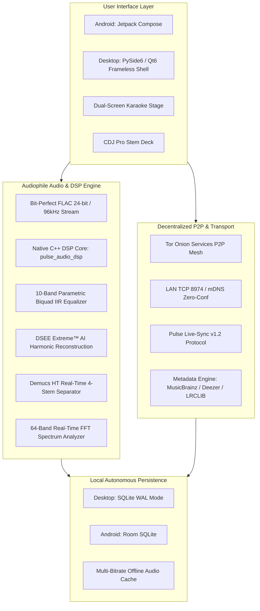
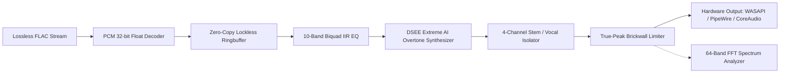

# 🏛️ PulseMusic Architecture & Engineering Specification

## 1. System Overview

PulseMusic is designed with a decentralized, serverless architecture that prioritizes audiophile audio fidelity, local data autonomy, and private peer-to-peer connectivity.

---

## 2. Audio Processing Pipeline

The audio engine processes incoming streams without destructive intermediate resampling:

### Digital Signal Processing (DSP) Chain
1. **Decoded Floating-Point Stream:** 32-bit floating-point audio data normalized to `[-1.0, +1.0]`.
2. **10-Band Parametric Biquad IIR Filter:** Frequency bands at 31Hz, 62Hz, 125Hz, 250Hz, 500Hz, 1kHz, 2kHz, 4kHz, 8kHz, 16kHz with adjustable Q-factor and preamp headroom control.
3. **DSEE Extreme™ AI Reconstruction:** High-frequency spectral extrapolation identifying compressed cutoffs (e.g., 16–20 kHz) and synthesizing natural acoustic overtones up to 24+ kHz.
4. **Demucs HT AI Source Separation:** Real-time deep neural network separating audio into **Vocals**, **Drums**, **Bass**, and **Instruments**.
5. **Phase-Accurate 64-Band Spectrum Analysis:** Hardware-accelerated Fast Fourier Transform computed at 60 FPS with ballistic peak decay.
