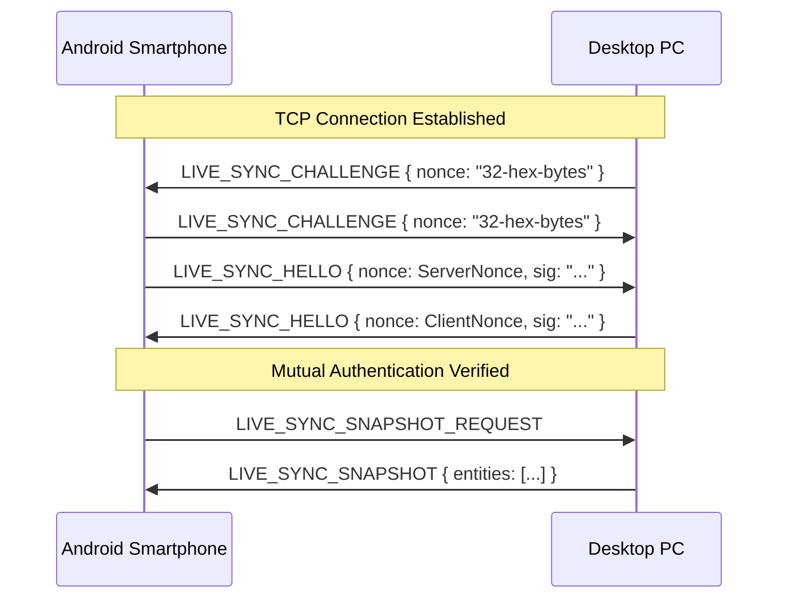

# 📡 Pulse Live-Sync Protocol Specification (v1.2)

The **Pulse Live-Sync Protocol** defines real-time, peer-to-peer data synchronization and remote control between PulseMusic clients (e.g., Android smartphone and Desktop PC) without requiring centralized cloud infrastructure.

---

## 1. Network Transport & Discovery

- **Local Network (LAN):** Desktop listens on TCP port **8974** (fallback ports: 8976, 8978, 8980). Discovered via mDNS service record `_pulse-desktop._tcp`.
- **Decentralized WAN (Tor):** Tor Onion v3 services provide encrypted end-to-end routing when outside the local network.
- **Wire Format:** Newline-delimited JSON objects encoded in UTF-8.

---

## 2. Cryptographic Security & Anti-Replay Handshake

Pairing generates a shared 32-byte secret key ($K$) via QR code or PIN exchange (`pulse://pair?host=<ip>&port=8974&id=<id>&key=<base64url>`). Every message carries a digital signature:

$$\text{sig} = \text{HMAC-SHA256}(K, \text{canonical\_json})$$

### Handshake Sequence

---

## 3. Clocks & Conflict Resolution

- **Hybrid Logical Clock (HLC):** String formatted as `"<timestamp_ms>-<counter_4_digits>-<device_id>"`.
- **Conflict Strategy:** Last-Write-Wins (LWW) per entity using lexicographical HLC comparison.
- **Tombstones:** Deleted items produce an explicit tombstone record stored for 30 days to prevent resurrecting deleted entities during asynchronous reconciliation.

---

## 4. Entity Types

| Entity | Primary Key | Payload Description | Resolution Strategy |
| :--- | :--- | :--- | :--- |
| `like` | `songKey` | Song metadata, `liked: true` | LWW via HLC; deletion sets `liked: false` |
| `playlist` | `playlistId` (UUID) | Name, description, artwork, track list | LWW per entire collection |
| `history` | `<origin>/<seq>` | Played track, timestamp, duration listened | Append-only log |
| `saved_episode` | `episodeKey` | Podcast episode metadata, audio stream URL | LWW via HLC |
| `followed_artist`| `artistKey` | Name, picture URL, verified status | LWW via HLC |
| `remote_cmd` | `msgId` | Remote player controls (play, pause, seek, karaoke, vocal volume) | Ephemeral real-time dispatch |
